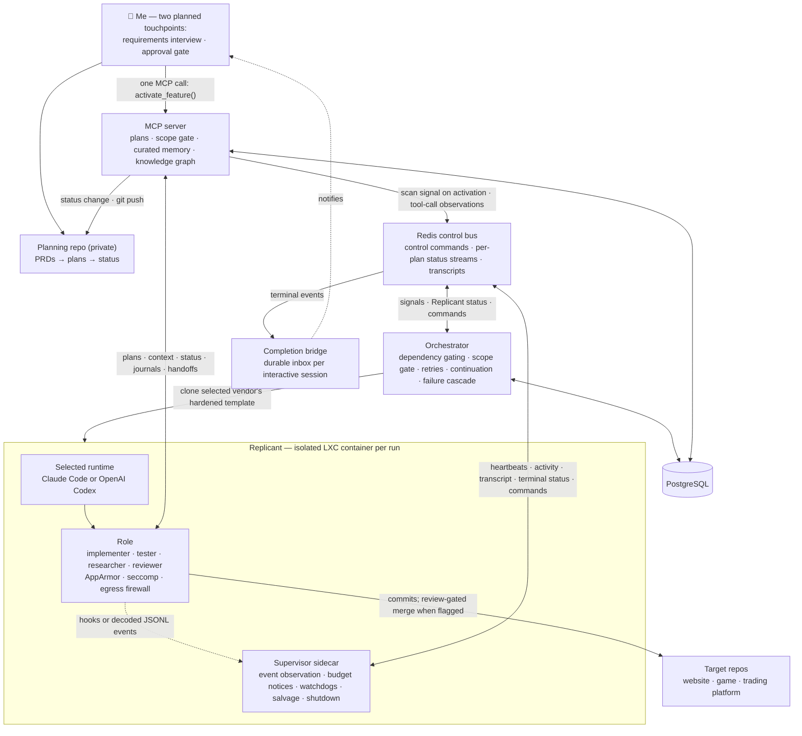

# FishTank

An AI software delivery platform, and the live projects its **Replicants** build and maintain.

A **Replicant** is FishTank's autonomous AI agent: assigned a plan and a role, running in an isolated container, and backed by shared institutional memory. Replicants use Claude Code or OpenAI Codex to execute their work.

FishTank is a one-person experiment taken to its logical end: what does software engineering look like when the engineer never writes the application code? I built a system that orchestrates Replicants to take a feature from an idea, through requirements and planning, to implementation, QA, code review, and deploy — with me participating at two planned points: the requirements interview and the approval gate. Past those, the pipeline runs autonomously on homelab infrastructure and pulls me back in only when it escalates something it cannot settle on its own.

> **The platform's source is private** (planning repo, orchestrator, MCP server, Replicant profiles).
> This repo documents the architecture and hosts the public projects the platform maintains —
> the [the-fish-tank.com](https://the-fish-tank.com) site and its weather-prediction pipeline.

  

**Things it has shipped:**

- 🎣 **[Fathom Fall](https://fathomfall.com)** — a Phaser 3 roguelike (100 floors, 7 zones, asynchronous PvP ghost battles), playable now. Built end-to-end by Replicants. [Showcase →](https://github.com/GuppitusMaximus/fathom-fall-showcase)
- 🌊 **[the-fish-tank.com](https://the-fish-tank.com)** — interactive physics simulations, plus a weather-station ML pipeline. Both live in this repo.
- 📈 A quantitative trading research platform (private) — event-driven, exchange-safe, shadow-mode only. [Showcase →](https://github.com/GuppitusMaximus/tankcore-showcase)
- 🏗️ Its own infrastructure — Replicants write most of the Ansible code that runs it; applying privileged host changes stays with an authorized operator session.

---

## Architecture

Plans are markdown files with metadata headers. A plan's `Profile` selects its Replicant's role and write permissions; `Vendor` and `Model` select its Claude Code or OpenAI Codex runtime, including OpenAI/Sol (`gpt-5.6-sol`). The two runtimes use separate container templates and credentials but enter the same orchestration, dependency, review, and role-confinement pipeline. Vendor and model selections persist across retries and generated follow-up plans.

Before any of that, a plan has to pass a deterministic scope gate. Every file the plan declares it will modify is checked against what its role may write. The check runs when I activate — one out-of-scope plan rejects the whole batch and changes nothing — and again at dispatch, immediately before a container is created. A plan that fails the gate is sent back for correction, not retried.

The orchestrator is event-driven, with a periodic sweep behind it, so a lost signal delays work instead of losing it. A single MCP call activates approved plans and signals them over a Redis control bus. The orchestrator deploys a plan once everything it depends on has completed, runs independent work in parallel up to a concurrency limit, sequences plans dispatched together that declare the same file, retries eligible failures with backoff, and cancels the dependants of a foundation that has permanently failed. Trouble at a model provider is not treated as a plan failure: a rate or usage limit pauses dispatch for that vendor until it resets, and a bounded run of such errors costs the plan none of its attempts.

Each Replicant executes in a fresh LXC container, cloned from a template and destroyed afterwards, as one of four roles — implementer, tester, researcher, or reviewer — with role-specific filesystem permissions and external confinement. Replicants running Claude Code expose tool activity through hooks; those running Codex emit JSONL events that the supervisor decodes into the same liveness and progress stream. Claude Replicants run under a turn budget and Codex Replicants under a wall-clock limit; both receive the same three-stage budget notices before the limit, counted in turns for one and minutes for the other. Codex has controlled access to its model service through a dedicated forward proxy. Claude's OpenTelemetry telemetry has no Codex equivalent yet.

The supervisor sidecar is the Replicant's black box and exit handler. It reports heartbeats, tool activity, and terminal status, and streams the Replicant's transcript on a channel of its own; the orchestrator infers step progress from that activity when a Replicant does not report it. Two watchdogs end a Replicant that never becomes ready or that goes silent. On exit the supervisor records why the Replicant stopped, preserves recoverable work — committed or not — for the orchestrator to publish, checks every path the run pushed against its role's write scope, and participates in orderly shutdown. Plans flagged for review open a pull request and wait in a review state; they complete only on an approving review.

My own sessions are subscribers too. A durable completion bridge reads the plan status streams into a private inbox for each interactive conversation, so a session that activated plans learns how they ended even after a disconnect or a context compaction. Every event is reconciled against the authoritative plan state before anything acts on it — silence, or a gap in the stream, is never read as success — and Replicants themselves are not allowed to subscribe.

## The part that answers “but do you trust the code?”

Replicants produce code, and the platform enforces the boundaries that make their output trustworthy. FishTank's approach combines layered enforcement with live-container probes:

- **Write scope is enforced in layers.** Before a run, the scope gate rejects a plan whose declared files fall outside its role. During a run, Claude's pre-tool-use hook provides readable refusals for tool-mediated writes and fails closed when it cannot classify one, while both runtimes use role-specific AppArmor policies at the kernel and filesystem permissions on protected existing files. After a run, the supervisor checks every path that was pushed or salvaged against the same policy, and a violation fails the plan without a retry. The permissions pass cannot prevent creation of a new file in a writable directory, and Claude's hook does not extend to Codex. Those boundaries are why the layers overlap, and they matter when interpreting the probe results.
- **Loaded is not the same as applied.** Early probes found AppArmor profiles loaded in enforce mode but attached to no Replicant process. Then a bug in the probe itself read a confined process as unconfined, and the wrong headline stood for several more runs. Verification now reads the running process's own confinement label; a loaded policy alone is not evidence that a Replicant is confined.
- **Separation of duties.** Replicants acting as implementers cannot modify tests; testers can change tests and report defects but not application source; reviewers are read-only. Role definitions and protected repository policy are outside every role's write scope.
- **Implementation and QA are paired.** By planning rule, each implementation plan is written with a companion QA plan. QA checks acceptance criteria and files structured bug reports that become correction plans.
- **Review gates are explicit.** A plan that requires review stops in a review state when its Replicant finishes; it does not merge merely because the work is done.
- **Execution remains observable.** The supervisor records activity and status even when a Replicant forgets to narrate its own progress, and streams each run's transcript. Claude telemetry flows through OpenTelemetry into Prometheus and Loki, with Grafana dashboards. Codex JSONL activity and raw usage are captured by the supervisor; OpenTelemetry parity for Codex remains follow-up work.

## Institutional memory

Each Replicant starts with a fresh context, so FishTank maintains a PostgreSQL-backed memory layer that transfers useful knowledge across Replicants and preserves progress across runs:

| Layer | What it holds | The question it answers |
|---|---|---|
| **Exploration cache** | Per-file summaries written by Replicants, searchable patterns, provenance, and staleness | “What did the last careful reader learn about this file?” |
| **Insight store** | Curated, topic-keyed conventions and non-obvious landmines, each with a verification date and a source | “What mistake will look reasonable and waste the next hour?” |
| **Knowledge graph** | Components and file ownership, dependency links, and traced flows, with verification timestamps on components and links | “What calls this, what does it call, and which flows cross it?” |
| **[Plan handoffs and journals](#replicant-handoffs-and-continuation)** | Completed work, remaining steps, decisions, gotchas, and references to saved code | “Where did the previous Replicant stop, and how do I carry on?” |

The cache is deliberately curated. Reading a file does not manufacture a summary, and routine refresh preserves prose written by Replicants. When a plan that modified a tracked file completes, or the file disappears, its summary remains available but is marked stale until a Replicant re-reads and deliberately replaces it. Project identities are normalized so aliases do not split one codebase's memory. Lookup can target an exact file or use ranked full-text search across insight topics, insight text, file summaries, and patterns, with substring fallback. Unfiltered queries return counts, and a separate file index shows coverage and staleness without dumping the whole cache into context.

The knowledge graph is file-oriented. A Replicant uses `query_graph` to look up the file it already has, a component, or a flow. Plan file retrieval injects matching ownership, callers, callees, and flow context automatically. Replicants record observed dependencies through `map_link`, which resolves the endpoints and upserts the relationship. Components can own several files or claim a directory, and explicit symbols allow several components to share a module. Verification timestamps record when components and links were mapped or rechecked; a filesystem timestamp alone does not make them fresh.

Graph rebuilds run beside a real checkout, not on the database host. A walker derives components and direct import links as a document; whoever runs the rebuild submits it through the same component and link primitives used for incremental mapping. Reconciliation removes missing machine-built entries while preserving knowledge mapped by Replicants as stale when its files disappear, unless an explicit prune is requested. The walker is intentionally structural: higher-level HTTP, event, gRPC, and database relationships still require evidence-based mapping by a Replicant.

Memory arrives where it is useful: cached file context and graph neighbourhoods are attached to plan files, along with a short ranked list of project insights. Each insight states when it was last verified and where it came from, and is marked “verify first” once it has gone 60 days unconfirmed. When a plan completes, the gotchas its Replicant journaled against specific files are promoted into the insight store, so the next plan that touches those files is offered them. Focused search remains available for surprises. The aim is not maximum context. It is the smallest trustworthy context that prevents rediscovery and exposes change impact before editing.

### Replicant handoffs and continuation

**A plan can outlive the Replicant executing it.** When a Replicant stops at a checkpoint or reaches an execution limit, the orchestrator can deploy its successor to continue the same plan with a fresh context window. The handoff store and run journal preserve the institutional memory for that unfinished work across generations of Replicants.

When the supervisor issues a checkpoint notice, the Replicant commits and pushes its work, then calls `save_handoff` with what it completed, what remains, and the decisions or gotchas its successor needs. PostgreSQL stores that handoff and the run journal; Git stores the actual code. The supervisor independently records the exit, observed progress, and Git state, and attempts to preserve recoverable work — including work that was never committed — if the Replicant exits before completing its own handoff.

The successor Replicant calls `get_previous_attempt()` at startup to retrieve its predecessor's handoff, the supervisor's exit record, step progress, recent journal entries, and recovery references. It checks the saved commits, recovers any available salvage branch, skips completed steps, and resumes at the first unfinished one. The predecessor's decisions and warnings arrive with the work, so its successor can continue without rediscovering them.

Replication keeps the same plan attempt and is capped at three replacements per attempt. A guard stops further replication when successive records show the same step and commit; the ordinary retry policy then applies. Eligible exits are checkpoints, turn-budget exhaustion, and Codex wall-clock timeouts. Explicit cancellation and security violations do not trigger replication. Advance budget notices reach both runtimes: Claude through its tool hook, Codex at the top of its next shell command's output.

## The infrastructure

FishTank runs on a single-node Proxmox homelab (Ryzen 7 7700, 64 GB DDR5, 2 TB NVMe, and a 2 × 12 TB ZFS mirror), managed as code:

- **Infrastructure as code** — 40 Ansible roles, Molecule and pytest checks, vault-encrypted secrets, and a daily check-mode drift run that alerts on drift and on its own failure to run
- **One deploy path** — approved plans enter through the MCP activation path and the orchestrator owns the Replicant lifecycle
- **Recoverability** — scheduled snapshot-mode guest backups, daily database dumps, and restore checks that load a dump into a scratch database to prove it
- **Monitoring** — Prometheus, Loki, and Grafana (17 dashboards, 78 alert rules) with alerts delivered as mobile push; the same stack watches the shipped game's cloud-hosted production backend
- **Self-maintenance** — a janitor removes abandoned checkouts only once their work is archived, and a disk-pressure trigger runs the cleaners early when space runs low
- **Remote access** — Cloudflare Tunnel, Access, and private routing for remote entry and administration, with Tailscale kept as a break-glass path
- **Two Replicant runtimes** — separate Claude and Codex container templates, shared role boundaries, and runtime-appropriate supervision

---

## Live projects in this repo

The showcase above describes the private platform. The projects below live *in this repo* and are what it publicly maintains — the site deploys from `main` via GitHub Pages, and the weather pipeline runs on GitHub Actions.

### [the-fish-tank](FrontEnds/the-fish-tank/) — [the-fish-tank.com](https://the-fish-tank.com)

Interactive web experiences in vanilla HTML/CSS/JS, no frameworks:

- **Fish Tank** — click-to-spawn swimming fish with physics
- **Tank Battle** — autonomous combat vehicles with turret AI
- **Fighter Fish** — aerial dogfight with flight physics and missiles
- **Home** — temperature forecast powered by the-snake-tank's ML model

### [the-snake-tank](BackEnds/the-snake-tank/) — weather data + ML pipeline

- Collects readings from a Netatmo weather station on a GitHub Actions schedule
- Stores history in SQLite; trains a RandomForest model to predict next-hour indoor/outdoor temperature
- Publishes prediction JSON consumed by the site's forecast widget

---

## Build log

How the platform evolved — from a single Claude Code session to the orchestrated system above, one wall at a time — in [BUILDLOG.md](BUILDLOG.md).

## FAQ

**Why is the platform private?** Parts of it are directly monetizable, and the Replicant profiles and planning corpus are the product of months of iteration. The architecture is documented here precisely because the ideas are worth sharing even where the implementation is not.

**Did Replicants really write all of it?** Replicants write the application code in the target projects. My contributions are requirements, plan approval, and the platform and infrastructure design.

**Can Replicants use different models?** Yes. A plan selects Claude Code or OpenAI Codex, plus a compatible model. Replicants share the same orchestrator and role model, while container templates, credentials, event capture, limits, and network paths remain runtime-specific.

**What's it built with?** Claude Code and OpenAI Codex, Python, PostgreSQL, Redis, Proxmox VE, LXC/ZFS, AppArmor/seccomp, Ansible, Packer, Cloudflare, and an observability stack built around supervisor events, OpenTelemetry, Prometheus, Loki, and Grafana.
